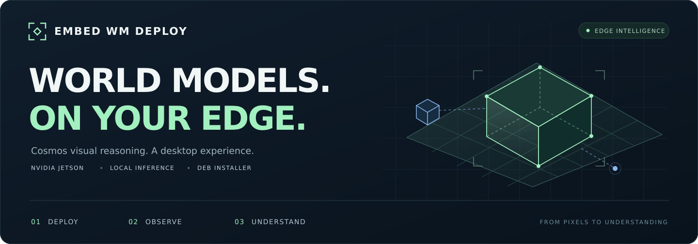
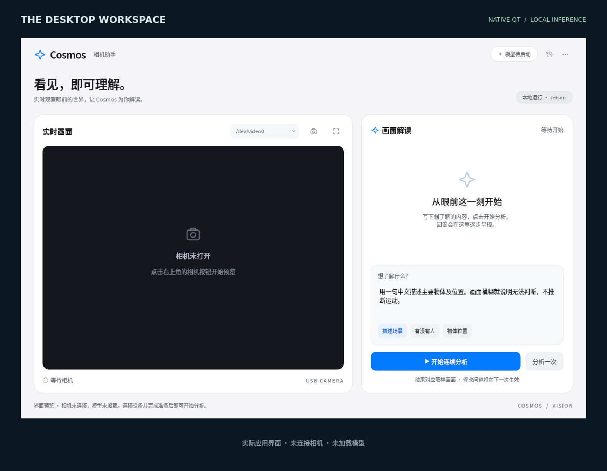
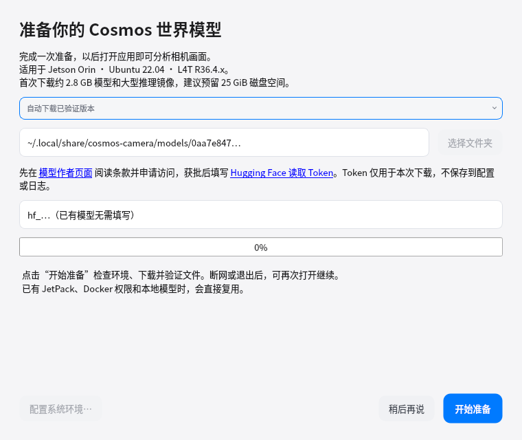
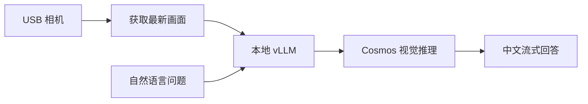

<p align="center">
  
</p>

<h1 align="center">Embed WM Deploy</h1>

<p align="center"><strong>让世界模型，运行在你的设备上。</strong></p>
<p align="center">面向 NVIDIA Jetson 的 Cosmos 视觉推理桌面应用<br>从一份 DEB 安装包，到可交互的本地场景分析。</p>

<p align="center">
  <a href="docs/release-notes.md"></a>
  
  
  
</p>

<p align="center">
  <a href="#quick-start">快速上手</a> &nbsp; / &nbsp;
  <a href="#workspace">界面预览</a> &nbsp; / &nbsp;
  <a href="#capabilities">核心能力</a> &nbsp; / &nbsp;
  <a href="docs/installed-app-guide.md">使用文档</a> &nbsp; / &nbsp;
  <a href="docs/github-release.md">构建与发布</a>
</p>

---

把 **Cosmos-Reason2-2B · INT4 量化模型**、**Jetson vLLM 推理环境**和**原生 Qt 桌面界面**整合进一套应用。安装、准备、开始分析：用 USB 相机观察场景，用自然语言提出问题，在设备上获得逐段生成的中文回答。

<a id="workspace"></a>

## 看见画面，读懂场景

<p align="center">
  
</p>

<p align="center"><sub>实际桌面界面预览 · 展示未连接相机、未加载模型时的状态。</sub></p>

<a id="capabilities"></a>

## 从部署到理解，一套工作流

<table>
<tr>
<td width="33%" valign="top">
<h3>01 / 轻松部署</h3>
<p>标准 DEB 安装、应用菜单入口、首次准备向导。模型自动下载，镜像版本固定，文件完整性自动校验。</p>
</td>
<td width="33%" valign="top">
<h3>02 / 持续观察</h3>
<p>USB 相机持续预览，分析时获取最新一张画面。支持单次与连续分析，预览和模型请求独立运行。</p>
</td>
<td width="33%" valign="top">
<h3>03 / 自然交互</h3>
<p>中文提问、流式回答、取样画面回看。场景描述、物体位置、自定义问题，直接在桌面完成。</p>
</td>
</tr>
</table>

**在设备上推理** · 模型服务只监听本机地址；默认不保存相机照片或视频。

**让运行状态可见** · 提供环境诊断、服务日志、模型启停与用户配置管理。

<a id="quick-start"></a>

## 三步开始使用

### 1 · 安装应用

<!-- release-links:start -->
**[查看发布与安装包](https://github.com/yuanimperialhal/Embed_WM_deploy/releases)** · [从源码构建 DEB](docs/github-release.md#2-本地验证)

当前尚未发布正式 Release。首次发布后可使用 [最新版 DEB 直链](https://github.com/yuanimperialhal/Embed_WM_deploy/releases/latest/download/cosmos-camera_latest_arm64.deb) 和 [SHA256 校验文件](https://github.com/yuanimperialhal/Embed_WM_deploy/releases/latest/download/cosmos-camera_latest_arm64.deb.sha256)。
<!-- release-links:end -->

拿到安装包后，无需解压，在文件所在目录执行：

```bash
sudo apt install ./cosmos-camera_latest_arm64.deb
```

也支持双击 DEB 使用图形安装器，或通过 `sudo gdebi ./cosmos-camera_latest_arm64.deb` 安装。

### 2 · 完成首次准备

打开应用菜单中的 **Cosmos 相机助手**，选择自动下载模型，或使用已有的完整模型目录。向导会检查环境、校验模型并准备推理镜像。

首次下载需要访问 [模型作者页面](https://huggingface.co/embedl/Cosmos-Reason2-2B-W4A16) 申请授权，并按提示填写 Hugging Face 读取 Token。如需配置 Docker 权限，向导会提示具体操作；新增用户组权限后需要重新登录桌面。

<details>
<summary>展开查看首次准备向导</summary>

<p align="center"></p>

支持模型下载暂停、重试和断点续传。Token 仅用于本次下载，不写入配置或日志。首次下载包含约 2.8 GB 模型和大型推理镜像，耗时取决于网络与设备。

</details>

### 3 · 点击开始分析

连接 USB 相机，点击 **开始连续分析**。应用自动启动本地模型服务，模型就绪后获取最新画面并显示回答；也可点击 **分析一次** 完成单张图片分析。

准备完成后，日常推理使用本地模型与镜像，无需重复下载。

## 为 Jetson 而构建

| 环境 | 当前支持 |
| :--- | :--- |
| 硬件 | **NVIDIA Jetson Orin · arm64**，原项目实机参考为 8 GB 设备 |
| 系统 | **Ubuntu 22.04 · JetPack 6 · L4T R36.4.x**，参考验证版本 R36.4.3 |
| 输入 | 图形桌面 + 兼容 V4L2 的 USB 相机 |
| 存储 | 建议至少 **25 GiB** 可用空间，Docker 存储盘也需预留空间 |
| 首次准备 | 系统软件源、Hugging Face 与 ghcr.io 网络访问，以及模型授权 |

安装包自动处理应用依赖；JetPack 和 NVIDIA 驱动须预先安装。当前未适配普通 x86 PC、Windows 或 macOS。

## 从相机到回答



当前接入 Cosmos 的视觉理解能力，**每次分析一张取样图片并输出文字**。预览帧率与推理速度不同，回答对应之前的取样画面；当前不提供视频生成、三维世界模拟或连续视频的时序推理。

## 文档与开发

| 想了解什么 | 从这里开始 |
| :--- | :--- |
| 安装、校验与常见问题 | [快速安装指南](docs/quick-start.md) |
| 界面操作、模型配置、升级卸载 | [安装版使用说明](docs/installed-app-guide.md) |
| 本地打包、GitHub Actions、发布验收 | [构建与发布指南](docs/github-release.md) |
| 每个版本的变化 | [发行记录](docs/release-notes.md) |
| 模型来源与第三方许可 | [第三方说明](THIRD_PARTY_NOTICES.md) |
| 单图基准、命令行与调参记录 | [开发参考](docs/development-guide.md) |

<details>
<summary>开发者：本地构建与项目结构</summary>

```bash
python3 packaging/build_deb.py
python3 tests/package_smoke.py dist/cosmos-camera_0.2.0-1_arm64.deb
```

```text
Embed_WM_deploy/
├── scripts/       桌面界面、相机、模型服务与准备向导
├── packaging/     DEB 构建和发布工具
├── config/        固定模型版本、文件校验与发布配置
├── tests/         后台逻辑、下载、界面与安装包验证
├── docs/          使用指南、项目图片与开发文档
└── .github/       持续集成与版本发布工作流
```

源码可在 Ubuntu amd64 或 arm64 主机上打包；生成的 DEB 面向 Jetson arm64。推送与 `VERSION` 一致的版本标签后，GitHub Actions 会执行验证并发布安装包。

</details>

**交付状态**：当前版本 `0.2.0`，软件层自动测试与包结构检查已通过。另一台干净 Jetson 上的完整安装、授权下载、真实推理与升级卸载，仍需按发布指南完成验收。项目源代码许可证待维护者补充，模型及第三方组件遵循各自条款。

---

<p align="center"><sub>Built on NVIDIA Cosmos · Powered by vLLM · Made for Jetson</sub></p>
