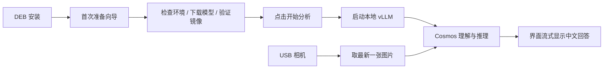

# Cosmos 相机助手

**在 NVIDIA Jetson 上，一键启动 Cosmos 世界理解模型，让 USB 相机画面变成中文分析。**

下载 DEB → 安装 → 打开应用完成首次准备 → 点击「开始连续分析」。应用会自动启动本地模型服务、获取最新画面，并逐段显示回答。

本项目集成 **Cosmos-Reason2-2B 的 W4A16 / INT4 量化版本**、Jetson vLLM 推理环境和原生 Qt 桌面界面。这里的“世界模型”具体指 Cosmos 的视觉理解与物理常识推理能力：当前应用逐张分析相机图片、输出文字；不生成视频，不模拟三维世界，也没有实现连续视频的时序推理。


## 下载安装

<!-- release-links:start -->
**[下载最新版 DEB（Jetson arm64）](https://github.com/yuanimperialhal/Embed_WM_deploy/releases/latest/download/cosmos-camera_latest_arm64.deb)** · [SHA256 校验文件](https://github.com/yuanimperialhal/Embed_WM_deploy/releases/latest/download/cosmos-camera_latest_arm64.deb.sha256) · [全部版本与更新说明](https://github.com/yuanimperialhal/Embed_WM_deploy/releases)

下载链接在首次 GitHub Release 成功发布后生效。
<!-- release-links:end -->

### 1. 确认设备

| 项目 | 当前版本要求 |
| --- | --- |
| 设备 | NVIDIA Jetson Orin，arm64；原项目实机参考为 Orin 8 GB |
| 系统 | Ubuntu 22.04、JetPack 6、Jetson Linux L4T R36.4.x；参考验证版本 R36.4.3 |
| 桌面 | 已登录图形桌面，连接兼容 V4L2 的 USB 相机 |
| 空间 | 建议至少 25 GiB 可用空间，用于约 2.8 GB 模型、容器和缓存；Docker 存储盘也需足够空间 |
| 网络 | 首次准备需要访问系统软件源、Hugging Face 和 ghcr.io |
| 模型访问 | 需要在模型作者页面获得访问权限，首次下载可能需要 Hugging Face 读取 Token |

这份安装包面向上述 Jetson 环境，普通 x86 Linux PC、其他 JetPack 版本、Windows 和 macOS 暂不支持。安装器会检查平台；DEB 不能替代 JetPack 刷机和 NVIDIA 驱动安装。

### 2. 安装 DEB

下载后**无需解压**。可以双击 `.deb`，使用系统软件安装器或 GDebi 完成安装；如果系统没有图形安装器，使用终端：

```bash
cd ~/Downloads
sudo apt update
sudo apt install ./cosmos-camera_latest_arm64.deb
```

习惯 GDebi 的用户也可以这样安装：

```bash
sudo apt install gdebi
sudo gdebi ./cosmos-camera_latest_arm64.deb
```

两种方式任选一种。包管理器负责安装 Python、Qt、OpenCV、字体、Docker 和 NVIDIA Container Toolkit 等依赖。需要系统启用了与当前 JetPack 匹配的软件源；若提示找不到 `nvidia-container-toolkit`，请先按 [NVIDIA 官方安装说明](https://docs.nvidia.com/datacenter/cloud-native/container-toolkit/latest/install-guide.html) 配置软件源。

可选完整性检查：把 DEB 和同名 `.sha256` 放在同一目录，执行：

```bash
sha256sum -c cosmos-camera_latest_arm64.deb.sha256
```

### 3. 第一次打开

在应用菜单搜索 **Cosmos 相机助手**，或者运行 `cosmos-camera`。

1. 准备向导中选择「自动下载已验证版本」，也可以选择已有的完整模型目录。
2. 下载模型前，到 [模型作者页面](https://huggingface.co/embedl/Cosmos-Reason2-2B-W4A16) 阅读条款并申请访问；获批后在向导填写具备该模型读取权限的 [Hugging Face Token](https://huggingface.co/settings/tokens)。Token 不保存在配置或日志中。
3. 点击「开始准备」。程序检查 Jetson 和 Docker，下载固定版本模型并验证 SHA256，再拉取固定摘要的 vLLM 镜像；中断后可重试并续传模型文件。
4. 如提示 Docker 权限或 NVIDIA runtime 未配置，点击「配置系统环境…」，根据系统提示授权。若本次添加了用户组权限，注销桌面并重新登录，再打开应用继续准备。
5. 完成后点击「进入相机助手」，再点击 **开始连续分析**。

首次下载和加载需要时间，取决于网络、磁盘和设备内存。模型下载准备完成后，日常推理在本机进行，无需再次下载权重。模型文件、配置和容器仍须保留。

系统配置按钮会启用 Docker，必要时注册 NVIDIA runtime 并重启 Docker，将当前用户加入 `docker`、`video` 组；操作前会说明影响并请求管理员授权。Docker 组具有管理员级能力。已有环境正常时无需执行该操作。

## 能做什么

| 功能 | 使用效果 |
| --- | --- |
| USB 相机实时预览 | 模型分析期间继续显示画面 |
| 一键启动模型 | 自动启动固定版本的本地 vLLM 服务并等待就绪 |
| 单次 / 连续分析 | 每次提交最新一张画面，避免旧图片不断排队 |
| 中文流式回答 | 模型边生成、界面边显示 |
| 自定义问题 | 可询问可见物体、位置、场景等；看不清时提示不确定 |
| 取样缩略图 | 展示回答对应的画面和取样时间 |
| 配置与诊断 | 保存模型目录、相机和问题，提供环境检查与服务日志 |
| 标准软件交付 | DEB、应用菜单图标、首次准备向导、版本升级与卸载 |

预览帧率与模型分析速度不同。回答对应之前取样的图片；当前应用不画检测框，不保证每帧推理，也不把模型生成内容当作准确的安全判断。

## 一键运行是怎么实现的



推理镜像按 SHA256 摘要固定，模型按 commit 和逐文件 SHA256 固定。模型服务只监听 `127.0.0.1`；默认不保存相机照片和视频，分析文字与运行信息保存在用户日志中。关闭窗口时释放相机，并停止由该窗口启动的模型服务。

GitHub 发布的是小型应用安装包。大型模型由每位用户从原作者处获取，容器从原始镜像仓库拉取。这样既避开 [GitHub 每个 Release 附件小于 2 GiB 的限制](https://docs.github.com/en/repositories/releasing-projects-on-github/about-releases)，也遵循当前量化模型页面标明的分发限制；旧的约 11 GB 私有离线包不进入公开发布流程。

## 升级、卸载和排错

升级：退出应用，下载新版 DEB，再执行同样的 `sudo apt install ./文件名.deb`。已有设置、模型和日志保留。

卸载：

```bash
sudo apt remove cosmos-camera
```

卸载只移除应用文件；个人模型、日志、Docker 镜像及系统环境配置保留，避免误删其他程序使用的数据。

| 内容 | 默认位置 |
| --- | --- |
| 应用 | `/usr/lib/cosmos-camera/` |
| 设置 | `~/.config/cosmos-camera/settings.json` |
| 自动下载的模型 | `~/.local/share/cosmos-camera/models/<固定版本>/` |
| 运行日志 | `~/.local/state/cosmos-camera/logs/` |
| 首次准备记录 | `~/.local/state/cosmos-camera/setup.json` |
| 推理缓存 | `~/.cache/cosmos-camera/` |

这些用户目录支持标准 XDG 路径设置。使用自备模型时，文件保持在用户选择的位置。

遇到问题，优先在「… → 检查运行环境」查看原因，或运行：

```bash
cosmos-camera --check
cosmos-camera --setup
```

401/403：确认模型访问已获批，Token 有读取该模型的权限。Docker 权限：完成系统配置后注销并重新登录。相机失败：检查 USB 连接，关闭其他占用相机的程序。内存不足：关闭其他大型应用，再查看模型日志。请使用普通用户启动界面。

## 开发与发布到 GitHub

版本：`0.2.0`。当前提供自动构建与软件层测试；另一台干净 Jetson 上的完整安装、授权下载、真实推理、升级与卸载仍需按 [发布验收步骤](docs/github-release.md) 验证。

本地构建：

```bash
python3 packaging/build_deb.py
python3 tests/package_smoke.py dist/cosmos-camera_0.2.0-1_arm64.deb
```

源码不含架构相关编译产物，可以在 Ubuntu 的 amd64 或 arm64 主机上构建 arm64 DEB；构建成功不代表能在 amd64 主机运行应用。

首次发布配置：

```bash
python3 packaging/configure_repository.py https://github.com/你的用户名/你的仓库名
```

提交项目后，推送与 `VERSION` 一致的 tag，例如 `v0.2.0`。GitHub Actions 会运行测试、构建和检查 DEB，上传安装包、校验文件和清单，然后发布 Release。README 的「下载最新版」直链保持不变，每个版本的专用文件名也会保留。

详细流程见 [GitHub 发布指南](docs/github-release.md)；用户操作见 [安装版说明](docs/installed-app-guide.md)；功能变更见 [发行记录](docs/release-notes.md)；依赖和模型条款见 [第三方说明](THIRD_PARTY_NOTICES.md)。旧的单图基准、相机命令行与调参记录见 [开发参考](docs/development-guide.md)。
# Embed_WM_deploy
# Embed_WM_deploy
# Embed_WM_deploy
# Embed_WM_deploy
# Embed_WM_deploy
# Embed_WM_deploy
