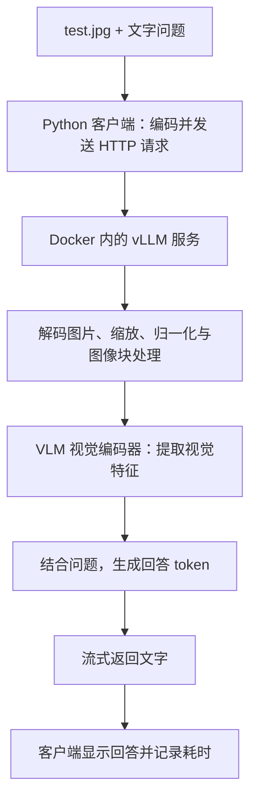

# 学习总结：用 vLLM 部署 VLM，并完成单图推理

> 开发参考文档：示例中的 `/path/to/cosmos-camera` 需换成实际源码路径；已安装软件的操作以 [安装版说明](installed-app-guide.md) 为准。

本文结合本项目的实际代码和成功运行记录，说明模型如何部署、图片如何被处理，以及怎样测量单图推理性能。

继续研究引擎源码、调度和 KV 缓存，可阅读从真实源码理解这套工程（原开发机文件：`../learning/vllm-0.19.0-cu126/README.zh-CN.md`，不随源码分发）。该材料附有从当前镜像导出的关键 Python 源码及校验清单，属于阅读快照，不是完整构建仓库。

## 1. 先分清 VLM、vLLM 和 Docker

**VLM 提供图片理解与文字生成能力；vLLM 负责运行模型并提供推理接口；Docker 提供运行环境。**

| 部分 | 本项目中的对象 | 负责什么 |
| --- | --- | --- |
| VLM：视觉语言模型 | Cosmos-Reason2-2B 的 W4A16 量化版本 | 根据图片和问题生成文字回答 |
| 模型架构 | Qwen3-VL | 定义视觉编码、语言生成等网络结构 |
| vLLM：推理服务引擎 | 已有容器中的 vLLM 0.19.0 | 加载模型、管理推理内存、调度 GPU 计算、提供 HTTP 接口 |
| Docker | 适配 Jetson 的 NVIDIA vLLM 镜像 | 提供 Python、PyTorch、CUDA 依赖及 GPU 访问环境 |
| 请求客户端 | `scripts/bench_image.py` | 读取图片、发送请求、显示回答、测量延迟 |
| 自动测试入口 | `scripts/run_single_image.py` | 内存采样、启动服务、执行两次请求、保存结果、停止测试容器 |

本地模型配置包含：

```json
{
  "architectures": ["Qwen3VLForConditionalGeneration"],
  "model_type": "qwen3_vl"
}
```

这表示模型采用 Qwen3-VL 架构。`cosmos` 则是本项目通过 `--served-model-name cosmos` 设置的接口别名。

W4A16 表示量化部分采用 4 位权重、16 位激活；并非所有网络层都被量化。启动时的 `--dtype half` 不会把已有 INT4 权重全部变成 FP16 权重。

## 2. 从图片到回答的完整过程



Python 客户端负责传输图片，视觉编码和回答生成发生在服务端执行的模型中。

## 3. vLLM 是怎样部署模型的

### 3.1 启动已有 Docker 镜像

自动脚本使用本机已有镜像，并通过镜像摘要固定版本。`--runtime=nvidia` 让容器能够访问 Jetson GPU 及相应运行环境。

宿主机不需要另外安装 vLLM、PyTorch 或 Transformers；这些依赖使用容器内的版本。

### 3.2 将本地模型目录挂载进容器

```text
宿主机模型目录：
/path/to/cosmos-camera/models/cosmos-download

容器内对应目录：
/model
```

挂载命令的核心是：

```bash
-v /path/to/cosmos-camera/models/cosmos-download:/model:ro
```

其中 `ro` 表示只读挂载，容器可以读取模型文件。

### 3.3 启动模型服务

容器内启动操作的核心是 `vllm serve /model`。实际运行还需要上下文、图片和内存参数，完整配置由自动脚本提供。

vLLM 会读取模型配置、`model.safetensors` 权重、分词器和图片处理配置，选择支持的模型实现，并初始化推理所需的 GPU 资源和 KV 缓存。

服务在本机提供接口：

```text
POST http://127.0.0.1:8000/v1/chat/completions
```

这是 OpenAI 兼容格式的本地接口。请求由本机 Jetson 处理，不需要调用 OpenAI 服务。脚本也设置了离线模型加载选项。

只有 `/health` 正常，且 `/v1/models` 返回 `cosmos`，自动脚本才开始发送图片。

## 4. 图片是怎样送进模型的

客户端先识别图片真实格式，再把文件内容编码为 Base64，构成 data URL：

```python
data_url = f"data:{mime};base64," + base64.b64encode(raw).decode("ascii")
```

本项目的 `images/test.jpg` 虽然后缀是 `.jpg`，实际文件内容是 PNG，因此客户端按照文件签名识别 MIME。

请求的核心结构如下，`data_url` 是上一段代码生成的变量：

```python
payload = {
    "model": "cosmos",
    "temperature": 0,
    "max_tokens": 1024,
    "stream": True,
    "stream_options": {"include_usage": True},
    "messages": [{
        "role": "user",
        "content": [
            {
                "type": "image_url",
                "image_url": {"url": data_url},
            },
            {
                "type": "text",
                "text": "请用中文简洁描述图片中可以直接观察到的内容。",
            },
        ],
    }],
}
```

- `image_url` 在这里包含内嵌图片数据，不要求把图片上传到网站。
- Base64 负责传输图片，不负责提取视觉特征。
- `temperature=0` 使用贪心生成，便于比较重复请求。
- `max_tokens=1024` 限制输出 token 数量，不是图片像素数或汉字数量。
- `stream=True` 让回答逐段返回，便于显示生成过程和测量首字延迟。

## 5. VLM 是怎样理解图片的

可以把推理过程分成四步：

1. **图片预处理**：解码图片，调整尺寸、归一化，并组织为模型需要的图像块。
2. **视觉编码**：视觉编码器把图像块转换成数字特征，供后续网络使用。
3. **处理图片与问题**：模型根据视觉特征和文字问题计算生成回答所需的状态，这部分通常属于预填充阶段（prefill）。
4. **逐步生成回答**：模型利用已有上下文和 KV 缓存，逐个生成后续 token，这部分称为解码阶段（decode）。

测试脚本没有重新实现视觉网络。相关执行逻辑已经封装在 vLLM 支持的模型实现中，具体能力来自加载的模型权重。

## 6. 为什么单图测试采用这些参数

| 配置 | 当前值 | 作用 |
| --- | --- | --- |
| 总上下文长度 | `--max-model-len 2048` | 图片、文字输入和输出合计的 token 预算 |
| 单次输出上限 | 自动入口默认 `--max-tokens 1024` | 限制生成长度；单独运行客户端时默认是 512 |
| 并发请求数 | `--max-num-seqs 1` | 一次处理一个请求 |
| KV 缓存大小 | `--kv-cache-memory-bytes 268435456` | 固定 256MiB，减少自动预留缓存带来的内存开销 |
| 初始空闲内存检查 | `--gpu-memory-utilization 0.1` | 降低本版 vLLM 的启动检查门槛；当前固定 KV 配置下，不表示总内存上限为 10% |
| 执行模式 | `--enforce-eager` | 关闭 CUDA Graph，减少其额外内存占用 |
| 每次调度 token 预算 | `--max-num-batched-tokens 512` | 限制单次调度的 token 预算 |
| 图片像素预算 | 最多 `262144` 像素 | 控制视觉处理开销；保留纵横比并按模型要求调整尺寸，不等于固定变成 512×512 |
| 图片处理缓存 | `--mm-processor-cache-gb 0` | 关闭图片处理缓存 |
| 提示词前缀缓存 | `--no-enable-prefix-caching` | 避免第二次直接复用第一次的提示词 KV |

KV 缓存保存生成时可复用的注意力键和值，减少重复计算。256MiB 只是 KV 缓存预算，模型权重、视觉编码器、中间张量和运行时还会占用内存。

## 7. 怎样实际运行

在设备终端执行：

```bash
cd /path/to/cosmos-camera
python3 scripts/run_single_image.py
```

自动流程依次完成：

```text
记录 1 秒内存基线
→ 启动容器与模型服务
→ 等待接口就绪并保存加载峰值
→ 第一次单图请求
→ 第二次单图请求
→ 保存结果并停止测试容器
```

每次运行创建独立的 `logs/single-image-日期时间/` 目录：

| 文件 | 用途 |
| --- | --- |
| `summary.json` | 整体状态、启动耗时、内存统计和两次请求结果 |
| `first.json`、`second.json` | 回答文本、首字延迟、总耗时、token 用量和停止原因 |
| `load-memory.json` | 服务就绪时保存的加载内存统计 |
| `memory.jsonl` | 带时间及阶段标签的内存采样 |
| `server.log` | vLLM 启动和运行日志 |
| `server-command.txt` | 本次使用的完整 Docker 命令 |

这是一套临时测试流程，测试完成会停止容器。要供网页或其他程序持续调用，需要另外保持 vLLM 服务运行。

如果服务已经由你手动启动并保持运行，可以单独发图：

```bash
python3 scripts/bench_image.py --max-tokens 1024 --output logs/manual-first.json
```

## 8. 三个性能指标怎样理解

| 指标 | 统计范围 | 主要限制 |
| --- | --- | --- |
| 加载内存采样峰值 | Docker 启动到服务就绪期间，整机共享 RAM 的最大采样值 | 包含其他进程和缓存；100ms 采样可能漏掉更短的瞬时峰值 |
| 首字延迟 | 发出 HTTP 请求到收到第一段非空 `delta.content` | 包含传输、图片处理、prefill 等；不含读图、Base64 编码、请求构造和模型启动 |
| 完整回答耗时 | 发出 HTTP 请求到正常收完响应流 | 不含模型启动和结果文件写入；截断或失败时不能称为完整回答耗时 |

客户端使用 `time.perf_counter()` 测量时间间隔。只包含 `role` 的流式事件不算出字；第一段非空 `content` 才会触发首字计时。

若模型把 `<think>` 等内容直接写在 `content` 中，它也计入首字；独立的 reasoning 字段另行记录。因此这里是客户端观察到的首段文字延迟，不是引擎内部精确的首 token 时间。

Jetson 的 CPU 和 GPU 共享内存。本项目使用 `tegrastats`，单位沿用其报告的 MB，同时保留 SWAP 数据。峰值减去基线只能说明整机观测到的增加量，不能等同于模型独占内存。

## 9. 已有成功运行记录

来源：成功测试汇总（原开发机文件：`../logs/single-image-20261022-233002-988662/summary.json`，不随源码分发）。两次请求都正常结束，`finish_reason=stop`，汇总状态为 `complete`。

| 项目 | 实测值 |
| --- | --- |
| 启动到服务就绪 | 127.22 秒 |
| 启动前 RAM 基线 | 4462 MB |
| 加载期间 RAM 采样峰值 | 7266 MB |
| 加载峰值相对基线增加 | 2804 MB |
| 加载期间 SWAP 采样峰值 | 3165 MB |

| 请求 | 首段文字延迟 | 完整回答耗时 |
| --- | --- | --- |
| 第一次 | 3.029 秒 | 8.898 秒 |
| 第二次 | 0.423 秒 | 6.373 秒 |

启动到就绪包含 Docker、进程和运行时初始化以及就绪轮询，不是纯权重加载耗时。第二次更快是本次观测结果，不能据此认定由某一种缓存造成。

这些是两次请求样本，且运行时存在明显 SWAP 使用，反映的是当时的机器状态。不能直接推导稳定平均值、P95 或服务吞吐量。系统磁盘缓存也未清空，因此首次请求不等于断电后的完全冷启动。

## 10. 运行不顺利时怎样定位

先查看该次测试目录的 `server.log` 和 `summary.json` 中的 `error`。

| 现象 | 判断与操作 |
| --- | --- |
| CUDA out of memory | 先关闭不需要的应用或服务，释放共享 RAM；也可缩小图片处理预算 |
| 端口占用 | 用 `--port 8001` 更换端口 |
| `finish_reason=length` 或 `status=truncated` | 回答达到输出或上下文上限；不能作为完整回答，可增加输出预算后重测 |
| 等待服务超时 | 查看加载日志，必要时用 `--startup-timeout 1800` 延长等待 |
| 算子、量化或架构不支持 | 根据完整错误定位运行环境兼容性；缩小图片不能解决不支持的算子 |

常用调整命令，每条分别运行，不要同时启动多份测试：

```bash
# 减少图片处理开销
python3 scripts/run_single_image.py --max-pixels 131072

# 更换端口
python3 scripts/run_single_image.py --port 8001

# 增加输出预算，仍需为图片和提示词保留上下文空间
python3 scripts/run_single_image.py --max-tokens 1536
```

## 11. 继续阅读本项目代码

- [自动测试入口](../scripts/run_single_image.py)：看模型服务如何启动、怎样划分采样阶段，以及如何结束测试。
- [图片请求与计时](../scripts/bench_image.py)：看图片编码、请求结构、流式响应处理和成功判定。
- [操作说明](../README.md)：查看参数说明、运行命令和输出文件。
- 模型配置（原开发机文件：`../models/cosmos-download/config.json`，不随源码分发）：查看模型架构与量化设置。
- 成功测试的完整启动命令（原开发机文件：`../logs/single-image-20261022-233002-988662/server-command.txt`，不随源码分发）：对照实际部署参数。
